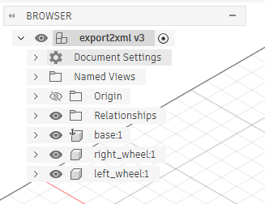
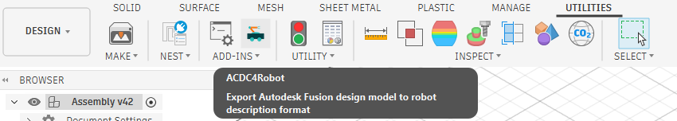
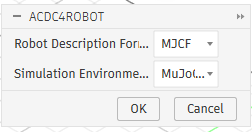

# MiniGoose hardware design
This repo contains the mechanical and electrical design of the **MiniGoose** robot. 
**MiniGoose** (also named **Ryan the Gosling**) is a 2-wheel differential drive balancing robot, which uses wheel encoders and IMU to stay upright and follow velocity commands.
The robot is controlled by an onboard PPO policy, which outputs the PWM motor controls.

The robot is built from 2 N20 DC motors, wheel encoders, IMU, ESP-32, a battery, and 3D printed wheels and chassis. For a complete bill of materials, visit [BOM](bom.md).
## Repository structure
```
/hardware-design
├── /cad                            
│   ├── /3dprint
│   │   ├── chassis_bottom.stl      # Bottom chassis plate
│   │   ├── chassis_top.stl         # Top chassis plate
│   │   └── wheel.stl               # Wheel (print 2x)
│   └── MiniGoose.f3d               # Fusion 360 source of the full assembly
│
├── /docs
│   └── /imgs                       # Documentation images
│
├── /wheel_robot_kicad
│   ├── wheel_robot_kicad.kicad_pro # KiCad project
│   ├── wheel_robot_kicad.kicad_sch # Schematic
│   └── wheel_robot_kicad.kicad_pcb # PCB layout
│
├── bom.md                # Bill of materials with prices and links
└── README.md
```
## Electrical design
## Mechanical design
This section describes the mechanical design of the robot, how to 3D print the parts, and how to export it to MuJoCo `.xml` file.

### 3D printing
The `/cad` folder contains the Fusion 360 assembly of the robot, as well as the 3D printable parts (bottom/top chassis, wheels).
Please keep in mind that the creator of the 3D model is a beginner in CAD, and such the model may be a bit scuffed (sorry :S).

We advise changing the 3D model and exporting new .stl files instead of using the ones attached, as some parts of the print depend on your printers accuracy and may therefore require a change of parameters, mainly the screw holes and wheel D-shaft connectors. 
Experiment with what parameters work for you, and use those for the final 3D print.
Especially the wheel shaft requires a tight fit to reduce backlash to a minimum (you can also always add some tape to the shaft to make it tighter :DD).

We also advise splitting the top chassis into the "box" part and "head part" to simplify the printing process, and gluing the head onto the chassis later.

After printing, we recommend adding some rubber on the wheels to increase friction. 
We found that using a snitched part of inner bike tube and just pulling it over the wheel provides enough friction and does not move around.

### Export to .xml
In the Fusion assembly, we model each electrical component, and roughly position it to where it is located in the robot.
We then use Fusion's physical materials to set the correct weight to each part (don't forget about the 3D printed ones), which helps to reduce the sim-to-real gap significantly.
Fusion does not allow changing the weight directly, so instead you have to inspect the part's volume (right click and pick *properties*), and calculate the density needed to achieve the desired weight.

While you may be able to get by with modelling the whole robot as a box and 2 cylinders for the wheels, this helps to reduce the sim-to-real gap significantly.

We use Fusion's add-in [ACDC4Robot](https://github.com/bionicdl-sustech/ACDC4Robot) to export the model to MuJoCo's .xml format.

Before exporting, organize the assembly into three top-level components, `base`, `right_wheel` and `left_wheel`, and connect each wheel to the base with a revolute joint.
That means that you have to copy over each body into the `base` component, and deleting every other component apart from the wheels. 
Don't forget to delete the prismatic joint joining the top and bottom chassis.
Each component becomes a body in the MuJoCo model, and each joint becomes a hinge.

<p align="center">
  
</p>

Then open the add-in from the *Utilities* tab under *Add-ins* → *ACDC4Robot*.

<p align="center">
  
</p>

In the dialog, set *Robot Description Format* to **MJCF** and *Simulation Environment* to **MuJoCo**, then click *OK* and choose an output folder.

<p align="center">
  
</p>